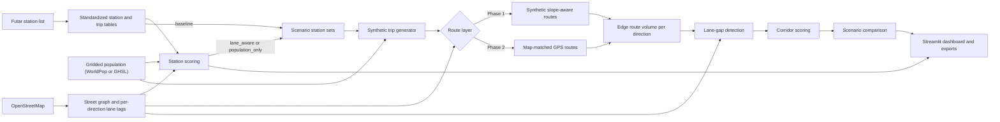
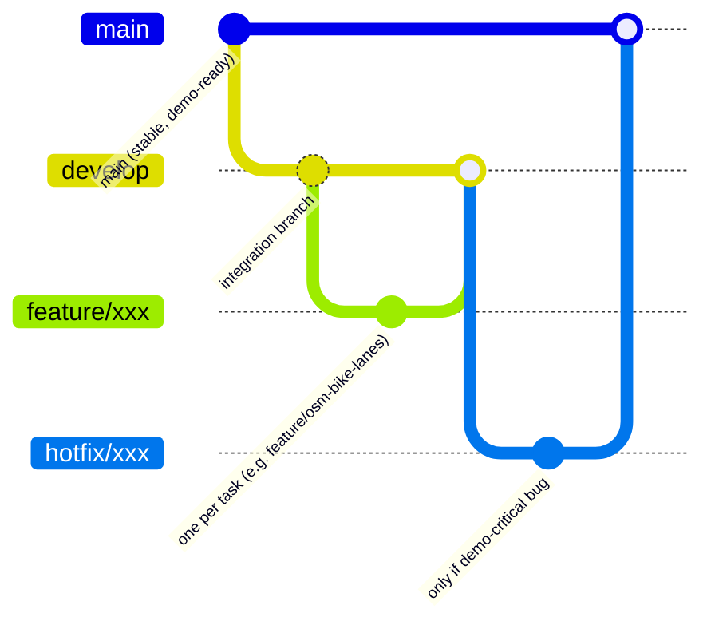

# MOL Bubi Bike-Lane & Station Recommendation Tool

### Technical Design Document

---

## 1. Purpose and scope

This document describes the design of an interactive map tool that uses MOL Bubi bike-sharing demand in Budapest to recommend:

1. **Bike-lane corridors** — high-use road segments (judged per direction) with no dedicated bike lane, ranked by priority.
2. **Station locations** — areas outside the walking coverage of existing stations, with enough population and a connection to existing bike lanes, ranked by priority.
3. **Scenario comparison** — bike-lane needs analysed under three station configurations (section 7.3).

**In scope:** data ingestion, OSM network processing, synthetic trip and route generation, gap detection, scoring, scenario comparison, an interactive dashboard, exportable results, and a methodology appendix.

**Out of scope:** legal, land-use, or construction feasibility; login systems; real-time services; elaborate ML models.

**Audience and success criterion:** a polished, technically transparent visual story for the informatics faculty dean and other professors, focused on city-infrastructure impact.

---

## 2. Agreed design decisions

| # | Decision |
| --- | --- |
| D1 | Trips and routes are generated **synthetically**; real trip and GPS data replaces the synthetic layers if and when it arrives. |
| D2 | Synthetic routing favors **flat and downhill** roads and **ignores traffic and existing bike infrastructure**. |
| D3 | A road direction counts as covered if it has **any** dedicated bike lane **in that direction**; coverage is judged per direction. The target is directions with high use and **no** lane. |
| D4 | New stations are recommended from **existing bike lanes and population density**, not from trip demand. |
| D5 | Synthetic trips, routes, and corridor rankings are an **algorithm demonstration**, labelled as such, never evidence of real cyclist behavior. Station recommendations use real inputs (stations, OSM lanes, population). |
| D6 | The deliverable is an interactive dashboard plus technical documentation, with code on GitHub. |
| D7 | Routes are generated **in-house** on the local OSM street graph; no external routing service is used. |
| D8 | Synthetic trips come from a **gravity-style model driven by population only**, with no time-of-day patterns. |
| D9 | Station candidates are scored by the **product** of normalized factors, not a weighted sum. |
| D10 | Total demand **grows** when proposed stations are added. |
| D11 | Bike-lane needs are analysed in **three scenarios**: existing stations only, existing plus lane-aware proposed stations, and existing plus population-only proposed stations. |

---

## 3. System architecture

The pipeline is layered so that only the trip and route generation layers change when real data arrives.

**Stable layers (unchanged by real data):** coverage analysis, station scoring, corridor scoring, scenario comparison, dashboard. **Replaceable layers:** trip generation and route generation (synthetic → real trips and map-matched routes).

---

## 4. Technology stack

| Concern | Choice |
| --- | --- |
| Data handling | `pandas`, `GeoPandas`, `Shapely`, a raster reader for population data |
| Street network | `OSMnx` (street and walking networks), `NetworkX` |
| Population data | WorldPop or GHSL gridded population estimates, whichever proves more useful |
| Storage and checks | Parquet/GeoParquet tables; CSV and GeoJSON only for exports; one schema file checked in CI against small fixtures |
| Spatial indexing | `H3` hexagons |
| Dashboard | Streamlit with Folium or PyDeck, runnable locally and deployable later |
| Version control and CI | GitHub, formatting/linting, small test suite for scoring and data validation |
| Outputs | Interactive map, downloadable GeoJSON/CSV recommendations, short technical report |

---

## 5. Data contract (to be ratified)

The written data contract is the most important decision. It is deliberately small: seven tables plus one config file. Fields below are a **proposed starting point**.

| Table | Fields |
| --- | --- |
| `stations` | `station_id`, `name`, `lat`, `lon` (Futár snapshot) |
| `population` | `cell_id`, `population` |
| `edges` | `edge_id`, `osm_way_id`, `length_m`, `has_dedicated_lane`, `geometry` |
| `station_candidates` | `scenario`, `cell_id`, `population`, `lane_connectivity` (empty for `population_only`), `score`, `rank` (empty if not selected) |
| `routes` | `scenario`, `start_station_id`, `end_station_id`, `route_type` (`synthetic` or `observed`), `edges` (ordered list of `edge_id`), `trip_count` |
| `edge_scores` | `scenario`, `edge_id`, `volume`, `score`, `rank` |
| `corridors` | `scenario`, `corridor_id`, `edge_ids`, `score`, `rank` |

**Conventions**

- **IDs:** `station_id` is the Futár `id` as a string. Proposed stations use `new:<cell_id>`, so one ID space covers all stations; each scenario's configuration lists which proposed stations it includes. `edge_id` is `u-v-key` and is valid only for the frozen graph named in the config. `cell_id` is an H3 index at one fixed resolution (proposed: 9).
- **Routes:** rows with the same scenario, station pair, route type, and edge list are merged by summing `trip_count`.
- **Coordinates:** exchange data in EPSG:4326, compute distances and areas in EPSG:23700 (Hungarian national grid).
- **Storage:** tables are Parquet/GeoParquet; CSV and GeoJSON are exports only.
- **Derived views:** the scenario comparison is a view over `edge_scores`, not a table.

**Config file** (one file, same value on every row): scenarios (station sets, seed, parameters), frozen graph version and OSM extract date, station snapshot date, population source and year, H3 resolution, and CRS.

**Generator-to-route-engine hand-off:** four fields, `scenario`, `start_station_id`, `end_station_id`, `trip_count`. It is an agreed interface, not a stored table, so the two modules can be built in parallel.

**Real data:** `trips` and `gps_points` are not in the contract for now. When real data arrives, a conversion step writes `routes` rows with `route_type = observed`, and nothing downstream changes. Timestamp rules (store UTC, convert to Europe/Budapest for time-of-day binning) are defined then.

**Items the contract must also fix:**

- time coverage of real trip data, if it arrives (the plan targets at least one year);
- station source: the BKK Futár station list, saved as a frozen snapshot (an API key is needed);
- licensing and privacy terms for trip and GPS data, and attribution and licence terms for the population data;
- the **deadline for accepting real data** (proposed: end of week 4, so it can feed the week 5 scenario runs).

---

## 6. Module design

### 6.1 Ingestion and standardized tables

Pulls the station list from the Futár API and stores it as a snapshot; when real data arrives, a conversion step turns it into `routes` rows with `route_type = observed`. Validates against the data contract and normalizes IDs and CRS. Data-quality profiling and a data dictionary accompany it.

### 6.2 OSM network and bike-lane model

Downloads and normalizes the Budapest street and walking graphs with OSMnx and extracts bike-lane tags. Lane coverage is determined **per direction** of each edge, handling tags that are relative to the way direction (e.g. `cycleway:left/right`, `oneway:bicycle`) and parallel cycleways. The geoinformatics member defines which OSM tags count as a *dedicated bike lane* (per D3) and documents the rules. Edges are the unit of coverage, and OSMnx merges road pieces between intersections, so lane tags can differ along one edge. How that is handled (splitting edges where tags change, or a majority rule) is decided in week 2.

### 6.3 Synthetic trip generator

A gravity-style model creates trips between stations:

- `trips(i → j) ∝ P_i × P_j × f(d_ij)`, where `P` is the population in a station's catchment and `f` is a distance decay.
- A station's catchment is the population within walking distance; each person is assigned to their nearest station, so nobody is counted twice.
- Total demand is `k × Σ P_i` with `k` fixed, so demand grows as proposed stations add newly served population (D10).
- Population is the only driver; there are no time-of-day patterns (D8). Same-station trips are excluded.
- Output is seeded and handed to the route engine as station-pair counts (`scenario`, `start_station_id`, `end_station_id`, `trip_count`); no stored table is needed.

### 6.4 Synthetic route engine

For each unique station pair, computes a route on the street graph and weights it by trip count.

- Edge cost = length plus an uphill penalty, for example `cost = length × (1 + α · max(0, grade))`, with `α` tunable.
- Grade is signed; the reverse direction of an edge uses the negated grade. Downhill and flat edges receive no penalty.
- Elevation along bridge and tunnel ways is interpolated between their end nodes, so river or ground level does not create false slopes.
- Traffic and existing bike-lane presence are **not** inputs (D2).
- Routing runs locally on the OSMnx graph; no external routing API is used (D7).
- Requires an elevation source (DEM) for slope; the source is to be chosen in week 1.
- Routes are cached by station pair and the cache is shared across scenarios, so only pairs involving new stations are computed.
- Identical routes (same scenario, station pair, route type, and edge list) are merged by summing `trip_count`.
- Reports the number of unroutable pairs and the trips dropped on every run.
- Output follows the `routes` schema, with `route_type = synthetic`.

### 6.5 Bike-lane gap detection and corridor ranking

1. Count route volume per directed edge across all routes.
2. Select directed edges with no dedicated lane in that direction.
3. Score each edge, then merge adjacent high-scoring edges (same direction) into readable corridors.
4. Rank corridors.

### 6.6 Station scoring

Scores H3 cells outside the walking coverage of existing stations, applies the filters and scoring rules in section 7.2, and selects proposed stations greedily with a minimum spacing. It runs once per siting strategy (`lane_aware`, `population_only`) and does not depend on routes. Each selected cell becomes a proposed station with the ID `new:<cell_id>`.

### 6.7 Dashboard

Streamlit app with layers for stations, population, routes, bike-lane coverage, top corridors, and top station areas, plus a toggle between the three scenarios and layers showing differences from the baseline. Each recommendation shows its route volume, direction, lane-tag status, rank, scenario, and scoring reasoning. Exports GeoJSON and CSV.

---

## 7. Scoring methods

### 7.1 Bike-lane candidate score

For each directed road edge without a dedicated lane in that direction:

`score = route volume × missing-lane gap length × continuity factor`

- **Route volume:** number of routes traversing the edge in that direction. Because routing favors downhill, volume is direction-asymmetric, so the dashboard shows direction explicitly.
- **Gap length:** length of the edge lacking a lane.
- **Continuity factor:** rewards edges that connect to other high-scoring gap edges. Its exact definition is to be agreed in week 4 and documented in the appendix.

### 7.2 Station candidate score

Candidate cells are H3 hexagons. A cell must pass these filters:

- it lies **outside the walking coverage** of existing stations (initially **300–400 m**, measured along the walking network);
- its population is above a minimum.

Passing cells are scored with the **product** of normalized factors (percentile rank or log scale, applied before combining):

- `lane_aware`: `score = norm(population) × norm(lane connectivity)`
- `population_only`: `score = norm(population)`, with no lane input at all

Population is the gridded people count (WorldPop or GHSL) summed over the cell. Lane connectivity is a continuous measure (existing lane length within reach and its connection to existing stations along the lane network), not a hard filter: bike lanes in the outskirts are often fragmented, so a filter could remove nearly every candidate. A cell with no connection scores 0. The pass rate is tested on real OSM data in week 2, and the measure is defined by the end of week 3.

**Selection:** greedy. Take the top-scoring cell, exclude cells within the minimum spacing, and repeat until `N` stations are chosen. `N` and the spacing are parameters, identical in both strategies. H3 resolution is chosen so cell size is small relative to the walk threshold and tested in sensitivity checks. This method does not claim legal, land-use, or construction feasibility.

### 7.3 Scenarios and comparison

| Scenario | Station set | Siting rule |
| --- | --- | --- |
| `baseline` | existing stations | — |
| `lane_aware` | existing + `N` proposed | population × lane connectivity |
| `population_only` | existing + `N` proposed | population only |

- A scenario is a **configuration** (station set, seed, parameters), not a separate code path. All scenarios share the walk distance, spacing, `N`, generator parameters, and seed, so only the station sets differ.
- Total demand grows with the newly served population (D10). `population_only` captures denser areas and therefore adds more demand, so results are reported both in absolute terms and per newly served person. Because `lane_aware` stations sit on connected lanes, they need fewer new corridors by construction; the comparison therefore also reports population newly served per km of new corridor needed.
- Corridors are compared at edge level (scores and ranks) and then aggregated. Each corridor is labelled by the scenarios in which it ranks among the top corridors (cut-off defined in the appendix): robust if it appears in all three, station-dependent otherwise.
- Output is a scenario comparison, not a forecast.

---

## 8. Replacing synthetic data with real data

1. Accept real trips and GPS logs that conform to the data contract, with station IDs matched to the Futár station list.
2. Map-match each GPS trace to the OSM graph (method planned by the geoinformatics member).
3. Emit routes in the same Routes schema with `route_type = observed`.
4. Re-run coverage, scoring, scenario, and dashboard layers unchanged.

Scenarios with proposed stations still rely on the demand model for the new stations' trips. If no real data arrives by the contract deadline, outputs stay synthetic and clearly labelled.

---

## 9. Validation and demo criteria

**Demo storyline:**

1. Show current stations, population, and generated or observed routes.
2. Toggle bike-lane coverage against high-use corridors.
3. Show top corridors and station areas with transparent scores.
4. Compare the three scenarios and show which corridors are robust and which depend on new stations.
5. Explain the synthetic-to-real replacement path.
6. Include a methodology appendix with assumptions and limitations.

**Pre-presentation checks:**

| Check | Owner / method |
| --- | --- |
| Visual sanity review | Geoinformatics member |
| Stability | Recommendations remain broadly similar across random seeds and small changes to key parameters (`α`, thresholds); across time slices once real data arrives |
| Traceability | Every displayed recommendation links to its input counts and scoring logic |
| Scenario comparability | Scenarios differ only in their station sets (same seed, parameters, `N`, spacing) |

Sensitivity checks on thresholds and parameters are run by the data-science member.

---

## 10. Team ownership

| Member | Ownership |
| --- | --- |
| Geoinformatics MSc | OSM street and walking graph build and the `edges` table (per-direction lane coverage rules, edge granularity, frozen graph), DEM source selection, CRS/geospatial processing, walking-distance coverage, GPS map-matching plan, visual sanity review |
| Data Science MSc | Gravity-style trip generator, scoring methodology (normalization, continuity factor, corridor merging rules, lane-connectivity measure and its week-2 pass-rate test), sensitivity and stability checks, result validation (including scenario comparability) |
| BA / Data Science | Data dictionary, data-quality profiling (stations, population, lanes), catchment analysis, documentation (short technical report and methodology appendix) |
| BA / Data Analysis | Requirements traceability and the traceability check, evaluation metrics, dashboard narrative, presentation evidence, demo rehearsal, contingency screenshots/video |
| Project leader | Repository setup, project scaffold, CI (including contract schema checks), issue templates; data contract ratification; real-data acquisition and licensing; weekly acceptance and merges into `main` |
| CS 1 | BKK API key and Futár station ingestion, standardized station pipeline, conversion of real trip/GPS data into `routes` rows |
| CS 2 | Synthetic-route engine with slope-aware routing (grades, bridge and tunnel handling), shared route cache, route merging, unroutable-pair report; GPS map-matching implementation if data arrives |
| CS 3 | Per-direction gap detection and corridor-ranking implementation |
| CS 4 | Streamlit dashboard (from the week-1 wireframe), map layers, scenario toggle and comparison layers, exports |
| CS 5 | Population data (WorldPop/GHSL) evaluation and preparation, station scoring implementation, scenario runner and comparison metrics |

There are no sub-leads; the project coordinator handles priorities, integration, and weekly acceptance. Everyone owns one visible GitHub issue per week.

---

## 11. Schedule (7 weeks, about 4–5 hours per person per week)

| Week | Milestone |
| --- | --- |
| 1 | Kickoff, repository, data contracts, Budapest study area, Futár station snapshot, sample synthetic trips, dashboard wireframe; DEM and population sources chosen |
| 2 | Station ingestion and population-data preparation (WorldPop or GHSL); OSM street and walking networks downloaded and normalized; per-direction lane tags; edge granularity decided; lane-connectivity pass-rate test; baseline map |
| 3 | Gravity trip generator; synthetic slope-aware routes; lane-connectivity measure defined; first route visualizations |
| 4 | Per-direction lane coverage comparison and corridor scoring (baseline); station scoring for both strategies, in parallel |
| 5 | Scenario runs (`baseline`, `lane_aware`, `population_only`) and comparison; first complete dashboard with scenario toggle |
| 6 | Integrate real trip/GPS data if available; threshold tuning, sensitivity checks, and QA |
| 7 | Freeze results; rehearse live demo; final documentation; contingency screenshots/video |

Each person gets one narrowly defined outcome per week.

---

## 12. Development workflow

- `main` is always demo-ready. It receives `develop` at weekly acceptance, plus `hotfix` branches only for demo-critical bugs.
- `develop` is the integration branch.
- One short-lived branch per issue, branched from `develop`, e.g. `feature/synthetic-routing`, `feature/station-score`.
- Small pull requests into `develop`, reviewed by one teammate before merge.
- GitHub Projects board: Backlog → This Week → Review → Done.
- CI: formatting/linting plus a small test suite for scoring and data validation.

### Workflow visualization

---

## 13. Risks and limitations

### 13.1 Risks

Things that could go wrong during the project, with how each is handled.

| Risk | Mitigation |
| --- | --- |
| Real trip/GPS data may be unavailable or late | Fully synthetic trips and routes by design; contract deadline for GPS; outputs clearly labelled |
| The Futár API provides no historical trip data (only a live station list) | Stations come from Futár; trips are generated; real data is plugged in if obtained from another source |
| In-house routing depends on an elevation (DEM) source and on team effort (D7) | Choose the DEM source in week 1; keep the routing model simple (length plus uphill penalty) |
| Scenario differences are confounded by demand differences | Report absolute and per-served-person results; identical seed, parameters, `N`, and spacing |
| Three scenarios add compute and QA workload | Scenario as configuration, not code; shared route cache |
| The lane-connectivity filter could remove nearly every candidate station | Use a continuous measure; test the pass rate on real OSM data in week 2 |
| Mixed lane tags along one OSMnx edge distort coverage and gap length | Decide edge granularity in week 2 (split edges or majority rule) |
| Team of mixed GIS/DS experience at 4–5 h/week | Narrow weekly outcomes; small PRs; clear module ownership |
| Over-scoping | No login, real-time, or elaborate ML features |

### 13.2 Limitations

Built-in boundaries of what the results can claim; each is documented in the methodology appendix.

| Limitation | Handling |
| --- | --- |
| Synthetic trips, routes, and corridor rankings do not reflect real cyclist behavior | Labelled demonstration only (D5) |
| Demand is population-only, with no time-of-day, seasonal, or land-use effects | Gravity model by design (D8); revisit when real data arrives |
| Slope-only routing ignores traffic and lane preference | Deliberate simplification (D2) |
| Scenario differences partly reflect the demand model's assumptions | Presented as a scenario comparison, not a forecast |
| `lane_aware` stations need fewer new corridors by construction | Also report population newly served per km of new corridor |
| Station scores ignore legal, land-use, and construction feasibility | By agreement, scoring uses only population and existing lanes (D4) |

---

## 14. Open items

- Ratify the data contract, including the real-data acceptance deadline (proposed: end of week 4) and the scenario config file.
- Choose a DEM source for slope.
- Choose the population source (WorldPop or GHSL, whichever proves more useful), its product and year, and check its attribution and licence terms.
- Fix the OSM tag rule for "dedicated bike lane" per direction, including parallel cycleways.
- Set the initial walk distance (300–400 m, along the walking network) and H3 resolution.
- Fix the gravity model's distance measure and decay form.
- Set the number of proposed stations `N` and the minimum spacing.
- Define the lane-connectivity measure (by the end of week 3) and test its pass rate on real OSM data (week 2).
- Decide edge granularity: split edges where lane tags change, or use a majority rule (week 2).