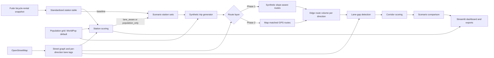

# MOL Bubi Bike-Lane & Station Recommendation Tool

### Technical Design Document

**Version:** 2.0 · **Revised:** 26 October 2026 · **Repository state:** `develop` at `786a65e`

This is a living design and implementation record. Behaviour described as **implemented** matches the code at this revision; behaviour marked **planned** is agreed but not yet in the repository. Where this document and `src/bubi/contracts/schemas.py` disagree, the schema is authoritative.

**Audience:** project teammates and reviewers from BKK (Centre for Budapest Transport, the city's public transport authority). Readers are assumed to be Python-literate but not necessarily OpenStreetMap (OSM) or network-analysis specialists. Domain terms and acronyms are defined on first use.

**Reading guide:** §1–§2 cover scope and decisions; §3 gives the current implementation status; §4–§5 specify the stack and frozen data contract; §6–§7 describe modules and scoring; §8–§9 cover the real-data path and validation; §10–§12 cover ownership, schedule, and workflow; §13–§14 list risks and open items.

## Contents

1. [Purpose and scope](#1-purpose-and-scope)
2. [Agreed design decisions](#2-agreed-design-decisions)
3. [System architecture](#3-system-architecture)
4. [Technology stack](#4-technology-stack)
5. [Data contract](#5-data-contract)
6. [Module design](#6-module-design)
7. [Scoring methods](#7-scoring-methods)
8. [Replacing synthetic data with real data](#8-replacing-synthetic-data-with-real-data)
9. [Validation and demo criteria](#9-validation-and-demo-criteria)
10. [Team ownership](#10-team-ownership)
11. [Schedule](#11-schedule)
12. [Development workflow](#12-development-workflow)
13. [Risks and limitations](#13-risks-and-limitations)
14. [Open items](#14-open-items)

---

## 1. Purpose and scope

This document describes the design of an interactive map tool that uses demand from MOL Bubi, Budapest's bike-sharing system, to recommend:

1. **Bike-lane corridors** — high-use road segments (judged per direction) with no dedicated bike lane, ranked by priority.
2. **Station locations** — areas outside the walking coverage of existing stations, with enough population and a connection to existing bike lanes, ranked by priority.
3. **Scenario comparison** — bike-lane needs analysed under three station configurations (§7.3).

**In scope:** data ingestion, OSM network processing, synthetic trip and route generation, gap detection, scoring, scenario comparison, an interactive dashboard, exportable results, and a methodology appendix.

**Out of scope:** legal, land-use, or construction feasibility; login systems; real-time services; elaborate machine-learning models.

**Audience and success criterion:** a polished, technically transparent visual story for the informatics faculty dean and other professors, focused on city-infrastructure impact. The repository also serves as the team's working engineering record; §3 states what actually runs today.

---

## 2. Agreed design decisions

| # | Decision |
| --- | --- |
| D1 | Trips and routes are generated **synthetically**; real trip and GPS data replaces the synthetic layers if and when it arrives. |
| D2 | Synthetic routing favors **flat and downhill** roads and **ignores traffic and existing bike infrastructure**. |
| D3 | A road direction counts as covered if it has **any** dedicated bike lane **in that direction**; coverage is judged per direction. The target is directions with high use and **no** lane. |
| D4 | New stations are recommended from **existing bike lanes and population density**, not from trip demand. |
| D5 | Synthetic trips, routes, and corridor rankings are an **algorithm demonstration**, labelled as such, never evidence of real cyclist behavior. Station recommendations are designed to use real inputs (stations, OSM lanes, population); at this revision only the station snapshot is real (§3.1). |
| D6 | The deliverable is an interactive dashboard plus technical documentation, with code on GitHub. |
| D7 | Routes are generated **in-house** on the local OSM street graph; no external routing service is used. |
| D8 | Synthetic trips come from a **gravity-style model driven by population only**, with no time-of-day patterns. |
| D9 | Station candidates are scored by the **product** of normalized factors, not a weighted sum. |
| D10 | Total demand **grows** when proposed stations are added. |
| D11 | Bike-lane needs are analysed in **three scenarios**: existing stations only, existing plus lane-aware proposed stations, and existing plus population-only proposed stations. |

Decisions recorded since the first draft, now fixed by code and configuration:

| # | Decision |
| --- | --- |
| D12 | The data contract is **frozen in code** as Pandera schemas in `src/bubi/contracts/schemas.py` and explained in `docs/data_dictionary.md`. Changing it is a recorded design decision, not an ad-hoc edit. |
| D13 | Stations come from the **`bicycle-rental`** snapshot of BKK Futár (BKK's real-time data API). Only fixed docking stations are kept: records with `type == "virtual"`, which is also exactly the set whose style icon is not `vehicle-rental/mol-bubi-floating`. Free-floating bikes are vehicles, not stations, and are excluded. The 18 October 2026 snapshot yields **704** fixed stations. |
| D14 | Tunable parameters live in `config/default_config.yaml`. Defaults at this revision: random seed 42; EPSG:4326 for exchange and EPSG:23700 (Hungarian national grid) for measurement; H3 (a hexagonal spatial index) resolution 9; uphill penalty α = 3.0; walking-coverage threshold 350 m; gravity scaling k = 0.05 and decay β = 0.0015 m⁻¹; candidate population floor 100; N = 10 proposed stations; minimum spacing 400 m; lane reach R = 400 m. |
| D15 | While the walking-network and routing layers do not exist, distance filters use **straight-line distance** in EPSG:23700. This is a documented lower bound on walking or network distance, not a substitute, and it is labelled wherever it affects a recommendation. |
| D16 | The gravity model emits **deterministic expected trip counts**; no sampling is performed, so the random seed is currently unused. Exponential distance decay is implemented; the power-law alternative listed in config is not. |
| D17 | The pipeline is a Python package under `src/bubi/`, installed with `uv`, validated with Pandera, tested with pytest, and linted/formatted with ruff. CI runs on GitHub Actions. |

---

## 3. System architecture

The pipeline is layered so that only the trip and route generation layers change when real data arrives.



**Intended stable layers (unchanged by real data):** coverage analysis, station scoring, corridor scoring, scenario comparison, dashboard. **Replaceable layers:** trip generation and route generation (synthetic → real trips and map-matched routes).

### 3.1 Module map

| Layer | Code | Status at this revision |
| --- | --- | --- |
| Contract schemas and I/O | `contracts/schemas.py`, `contracts/io.py` | Implemented; 8 schemas (7 tables + trip-matrix interface) |
| Futár raw snapshot | `ingestion/futar_snapshot.py` | Implemented |
| Station ingestion interface | `ingestion/futar.py` (`ingest_futar_stations`) | Implemented; frozen snapshot date in config |
| Processed station table | `ingestion/stations_table.py` | Implemented; produces `data/processed/stations.parquet` with 704 rows |
| Synthetic demand (gravity) | `demand/gravity.py` | Implemented |
| Station filtering, connectivity, selection | `stations/selector.py` | Implemented |
| Lane-connectivity pass-rate test | `stations/diagnostics.py`, `scripts/lane_connectivity_pass_rate.py` | Implemented; run on mock fixtures only |
| Edge route volumes | `corridors/scoring.py` → `calculate_edge_route_volumes` | Implemented |
| Gap scoring and corridor merging | `corridors/scoring.py` → `detect_gaps_and_score_edges`, `merge_edges_into_corridors` | Planned; both raise `NotImplementedError` |
| OSM network and lane model | `network/graph.py` | Planned; raises `NotImplementedError` |
| Population raster to H3 | `population/grid.py` | Planned; raises `NotImplementedError` |
| Slope-aware routing | `routing/router.py` | Partial: edge cost implemented, path search planned |
| Scenario runner and comparison | `scenarios/runner.py` | Planned; raises `NotImplementedError` |
| Dashboard | `dashboard/app.py` | Prototype: runs on fixtures or processed tables, CSV exports only, placeholder positions for proposed stations |
| Profiling and traceability | `profiling/profiler.py` | Partial: summary profiling implemented, traceability report planned |

At this revision the end-to-end pipeline **cannot** run: network, population, routing, gap scoring, and scenario orchestration are missing. The dashboard is the only component that runs interactively, and it falls back to mock fixtures when processed tables are absent. Statuses follow from reading each module; §9.3 lists the checks that were run.

---

## 4. Technology stack

| Concern | Choice in the repository |
| --- | --- |
| Language and runtime | Python ≥ 3.10 (`pyproject.toml`); CI installs Python 3.12 |
| Environment and dependency pinning | `uv`; `uv.lock` records resolved versions; editable install with `uv pip install -e ".[dev]"` |
| Data handling | `pandas`, `GeoPandas`, `Shapely`, `pyarrow` |
| Street network | `OSMnx` (street and walking graphs), `NetworkX` |
| Population data | WorldPop (gridded population dataset; config default `worldpop_2026_100m`) or GHSL (Global Human Settlement Layer); the source is not final (see §14) |
| Spatial index | H3 (hexagonal spatial index), resolution 9 |
| Projection | `pyproj`: coordinate reference system (CRS) EPSG:4326 for exchange, EPSG:23700 for measurement |
| Storage and checks | Parquet and GeoParquet tables, `pandera[geopandas]` schemas, YAML configuration |
| Dashboard | Streamlit, Folium, `streamlit-folium` |
| Tests and lint | pytest, ruff (line length 100; rules E, F, I, W) |
| Version control and CI | GitHub, GitHub Actions, issue templates for feature tasks and weekly milestones |
| Outputs | Interactive map, downloadable CSV results today; GeoJSON exports planned |

**Dependency notes (verified against `pyproject.toml` and imports):**

- `pyproj` is imported directly by `demand/gravity.py` and `stations/selector.py` but is not a declared direct dependency; it currently arrives transitively through GeoPandas. Declare it explicitly when the dependency list is next touched.
- `pydantic`, `pyyaml`, and `requests` are declared but not imported yet. Ingestion uses the standard library's `urllib`. No code loads the YAML config yet: functions take explicit parameters whose defaults match `config/default_config.yaml` (§5.3).
- Reading a population raster needs a raster library (for example `rasterio`), which is not yet declared. Add it when `population/grid.py` is implemented.
- OSMnx is declared but not imported yet.

---

## 5. Data contract

The written data contract remains the most important decision. It is deliberately small: seven tables plus one interface table, one config file, and one schema module. The contract is **frozen**: `src/bubi/contracts/schemas.py` is authoritative, `docs/data_dictionary.md` explains every column, and CI regenerates the committed fixtures and runs the schema tests against them.

### 5.1 Tables

| Table | Grain and key | Fields and constraints |
| --- | --- | --- |
| `stations` | One row per fixed station; key `station_id` | `station_id` string, unique; `name` string; `lat` in [47.0, 48.0]; `lon` in [18.0, 20.0]. Strict schema. |
| `population` | One row per H3 cell; key `cell_id` | `cell_id` string, unique, H3 resolution 9; `population` float ≥ 0. Strict schema. |
| `edges` | One row per **directed** edge; key `edge_id` | `edge_id` string `u-v-key`, unique; `osm_way_id` integer; `length_m` > 0; `has_dedicated_lane` boolean; `geometry` LineString. Extra columns are allowed (for example `u`, `v`, `grade`). |
| `station_candidates` | One row per candidate cell and siting scenario; key (`scenario`, `cell_id`) | `scenario` only `lane_aware` or `population_only`; `population` ≥ 0; `lane_connectivity` ≥ 0 and nullable; `score` ≥ 0; `rank` nullable `Int64` > 0, where null means "not selected". Strict schema. |
| `routes` | One row per route; grain (`scenario`, origin, destination, `route_type`, edge list) | `scenario` in {`baseline`, `lane_aware`, `population_only`}; `route_type` in {`synthetic`, `observed`}; `edges` ordered list **or** JSON string of edge IDs; `trip_count` > 0. Strict schema. |
| `edge_scores` | One row per (`scenario`, `edge_id`) | `volume` ≥ 0; `score` ≥ 0; `rank` integer > 0. Strict schema. |
| `corridors` | One row per (`scenario`, `corridor_id`) | `edge_ids` list or JSON string; `score` ≥ 0; `rank` integer > 0. Strict schema. |
| `trip_matrix` (interface) | Hand-off from demand generator to routing engine | `scenario` string (no allowed-values check); `start_station_id`; `end_station_id`; `trip_count` > 0. |

### 5.2 Conventions

- **IDs:** `station_id` is the Futár `id` as a string. Proposed stations use `new:<cell_id>`, so one ID space covers all stations; each scenario's configuration lists which proposed stations it includes. The `futar_00x` IDs in `tests/fixtures/` are mock values, not real IDs. `edge_id` is `u-v-key` and is valid only for the frozen graph named in the config. `cell_id` is an H3 index at resolution 9.
- **Directions:** `u-v-key` and `v-u-key` are different edges and are never normalised. The trailing key distinguishes parallel edges between the same node pair.
- **Scenarios:** allowed values are enforced in every table except `trip_matrix`; `station_candidates` deliberately excludes `baseline` because baseline has no proposed stations.
- **Routes:** rows with the same scenario, station pair, route type, and edge list are merged by summing `trip_count`. Routes may store `edges` as a Python list or a JSON array string; both are accepted by the implemented volume step. A single edge-ID string is also accepted for convenience. One representation should still be chosen for stored data (§14).
- **Coordinates:** exchange data in EPSG:4326; compute distances and areas in EPSG:23700. Schema constraints on `stations` act as a Budapest sanity check, not a substitute for CRS handling.
- **Storage:** tables are Parquet or GeoParquet; CSV and GeoJSON are exports only. `data/raw/` is git-ignored (source snapshots and rasters); `data/processed/` holds contract tables; `tests/fixtures/` holds tiny committed mock tables.
- **Derived views:** the scenario comparison is a view over `edge_scores`, not a stored table.
- **Strictness:** all schemas are strict except `edges`, which allows extra per-edge attributes. `coerce=True` converts values before validation, so a schema pass does not prove the input types were already correct.
- **Key uniqueness:** only single-column keys are checked by the schemas. Composite keys such as (`scenario`, `edge_id`) are a documentation convention, not an enforced constraint (§14).

### 5.3 Config file

`config/default_config.yaml` is the agreed parameter source. It currently records:

| Group | Values |
| --- | --- |
| Project | name `mol-bubi-recommender`, version 0.1.0, random seed 42 |
| Spatial | exchange CRS EPSG:4326, analysis CRS EPSG:23700, H3 resolution 9, study bounding box `[18.92, 47.35, 19.33, 47.61]` (min lon, min lat, max lon, max lat) |
| Network | frozen graph label `budapest_osm_2026w1`, `bike` street network, `walk` walking network, digital elevation model (DEM) source label `copernicus_dem_30m`, uphill penalty α = 3.0 |
| Demand | population source label `worldpop_2026_100m`, population floor 100 per cell, k = 0.05, exponential decay, β = 0.0015 |
| Station scoring | walk threshold 350 m, N = 10, minimum spacing 400 m, lane reach R = 400 m |
| Scenarios | the three scenario names and their siting rules |
| Paths | raw, processed, fixtures, and export directories |

Two caveats, both important for reproducibility: no code reads this file yet (defaults in function signatures currently match it), and the graph, DEM, and population labels describe intended sources, not verified artifacts. Wiring the config into modules is an open item (§14).

### 5.4 Real data

`trips` and `gps_points` are not in the contract for now. When real data arrives, a conversion step writes `routes` rows with `route_type = observed`, and nothing downstream changes. Timestamp rules (store UTC, convert to Europe/Budapest for time-of-day binning) are defined then. The implemented volume step already aggregates synthetic and observed routes of one scenario together; filter `route_type` first if only one source is wanted.

**Items the contract must still fix:** the real-data acceptance deadline (proposed: end of week 4, so it can feed week 5 scenario runs); BKK licensing and attribution terms for the station data, including whether raw snapshots may be redistributed; the OSM extract date and frozen graph artifact; the canonical representation of `edges`/`edge_ids`; and composite-key uniqueness. §14 tracks these.

---

## 6. Module design

Each module is developed against the frozen contract and committed fixtures, so work does not block on upstream modules. Module-level READMEs in `src/bubi/*/README.md` carry the same contracts plus development instructions.

### 6.1 Ingestion and standardized tables (implemented)

`ingestion/futar_snapshot.py` fetches the BKK Futár `bicycle-rental` endpoint, saves the response byte-for-byte under `data/raw/` (git-ignored), and writes a `*.meta.json` sidecar with retrieval time, endpoint without the API key, HTTP status, byte count, SHA-256, station count, counting method, and an inspection report. It refuses to overwrite an existing snapshot. The API key is read from `BKK_FUTAR_API_KEY` or a local `.env` file and is never written to disk.

`ingestion/stations_table.py` converts a raw snapshot into `data/processed/stations.parquet`. The raw response mixes fixed stations with free-floating bikes. The script selects fixed stations in two independent ways and writes the table only when both selections agree: `type == "virtual"`, and style icon not equal to `vehicle-rental/mol-bubi-floating`. The 18 October 2026 snapshot produced 704 stations: `station_id`, `name`, `lat`, `lon`, sorted by `station_id`.

`ingestion/futar.py` exposes `ingest_futar_stations`, which returns the same table as a DataFrame without writing it. Given `raw_path` it works offline; otherwise it reads the API key, saves the raw response under `data/raw/` first, and then converts it. It raises `IngestionError` if the key is missing, the response is not HTTP 200, or the two selection rules disagree. The frozen snapshot is recorded under `stations` in `config/default_config.yaml`: date `2026-10-18`, file `futar_bicycle_rental_20261018T163442Z.json`, and its SHA-256 digest.

Documented commands:

```bash
# Requires BKK_FUTAR_API_KEY (environment or .env); writes data/raw/.
python -m bubi.ingestion.futar_snapshot

# Requires a raw snapshot file; raw data is git-ignored, so a fresh clone has none.
python -m bubi.ingestion.stations_table data/raw/futar_bicycle_rental_<stamp>.json
```

The BKK key is held by a team member and is deliberately absent from the repository. Raw snapshots are git-ignored, so they are kept in the team's shared Google Drive folder `MOL-BUBI_DSC/raw_futar_bicycle_rental`; copy the required snapshot into `data/raw/` to run the conversion. Neither command was exercised during this revision because no key or raw snapshot was present in this checkout. Both are covered by tests with synthetic payloads in `tests/test_ingestion.py` and `tests/test_stations_table.py`. Acquisition evidence, including the record-type finding, is in `docs/ingestion_notes.md`.

**Planned:** conversion of real trip and GPS data into `routes` rows with `route_type = observed`.

### 6.2 OSM network and bike-lane model (planned)

`network/graph.py` currently raises `NotImplementedError` for both graph building and directed-edge extraction. The design is unchanged: download and normalize the Budapest street and walking graphs with OSMnx and extract bike-lane tags. Lane coverage is determined **per direction** of each edge, handling tags that are relative to the way direction (for example `cycleway:left`, `cycleway:right`, `oneway:bicycle`) and parallel cycleways. The geoinformatics member defines which OSM tags count as a *dedicated bike lane* (per D3) and documents the rules.

Edges are the unit of coverage. OSMnx merges road pieces between intersections, so lane tags can differ along one edge; whether to split edges where tags change or apply a majority rule is still open (§14). The config names `copernicus_dem_30m` as the elevation source and `budapest_osm_2026w1` as the frozen graph version, but no graph artifact, OSM extract date, or DEM file has been committed or documented yet.

### 6.3 Synthetic trip generator (implemented)

`demand/gravity.py` implements a gravity-style model, documented in `docs/gravity_model_spec.md`:

- `trips(i → j) ∝ P_i × P_j × exp(-β·d_ij)`, where `P` is the population in a station's catchment, `d` is straight-line distance in metres (EPSG:23700), and β = 0.0015 m⁻¹.
- A station's catchment is the population of H3 cells whose centroid is within 350 m and for which that station is nearest. Each cell is assigned to exactly one station, so nobody is counted twice; cells beyond 350 m from every station are unserved and excluded.
- Raw weights are scaled so total demand is `k × Σ P_i` with k = 0.05. Adding a proposed station that captures previously unserved cells raises `Σ P_i`, so demand grows (D10).
- Population is the only driver; there are no time-of-day patterns (D8). Same-station trips are excluded.
- The output is the in-memory `trip_matrix` interface (`scenario`, `start_station_id`, `end_station_id`, `trip_count`), validated by `TripMatrixSchema`. The fixture generator calls the model itself, so `tests/fixtures/sample_trip_matrix.parquet` always matches the documented formula.

Two limitations are explicit in the spec and in the signatures: distance is Euclidean rather than network distance, and the model returns deterministic expected values, so `random_seed` is currently ignored. Power-law decay is listed in config but not implemented. Property tests cover total demand, symmetry, absence of self-trips, distance decay, and demand growth (`tests/test_gravity.py`).

### 6.4 Synthetic route engine (partial)

`routing/router.py` implements only the edge-cost function, which is tested:

`cost = length_m × (1 + α · max(0, grade))`, with α = 3.0.

Flat and downhill edges receive no penalty; uphill edges do. The path search itself (`route_station_pairs`) raises `NotImplementedError`. The agreed design remains:

- For each unique station pair, compute a route on the directed street graph and weight it by trip count.
- Grade is signed; the reverse direction of an edge uses the negated grade.
- Elevation along bridge and tunnel ways is interpolated between their end nodes, so river or ground level does not create false slopes.
- Traffic and existing bike-lane presence are **not** inputs (D2).
- Routing runs locally on the OSMnx graph; no external routing API is used (D7).
- Routes are cached by station pair and the cache is shared across scenarios, so only pairs involving new stations are computed.
- Identical routes (same scenario, station pair, route type, and edge list) are merged by summing `trip_count`.
- The run reports the number of unroutable pairs and the trips dropped.
- Output follows the `routes` schema with `route_type = synthetic`.

A DEM source is named in config, but the graph, grade attributes, bridge/tunnel interpolation, cache, and report are all unimplemented.

### 6.5 Bike-lane gap detection and corridor ranking (partial)

Implemented: `calculate_edge_route_volumes` counts trip volume per directed edge. It validates required columns and numeric, non-negative `trip_count`; accepts `edges` as a list, tuple, NumPy array, JSON array string, or single edge-ID string; rejects malformed edge IDs; counts each route once per distinct directed edge even if the route traverses it twice; aggregates scenarios independently; sums synthetic and observed routes; ignores routes with no edges or zero trips; and returns one row per (`scenario`, `edge_id`) with `volume > 0`, sorted by scenario, volume descending, then `edge_id`.

Planned: filter directed edges with no dedicated lane in that direction, score them (§7.1), merge adjacent high-scoring edges of the same direction into readable corridors, and rank corridors. `detect_gaps_and_score_edges` and `merge_edges_into_corridors` currently raise `NotImplementedError`. There is no fallback: `edge_scores` and `corridors` cannot be produced yet, and the dashboard's corridor layers therefore rely on mock fixtures.

### 6.6 Station scoring (implemented)

`stations/selector.py` implements the full siting pipeline. The draft definition is in `docs/station_lane_connectivity.md`; tests are in `tests/test_stations.py`.

1. **Candidate filtering** (`filter_candidate_cells`): keep H3 cells with population ≥ 100 whose centre is more than 350 m from every existing station. Distance is straight-line in EPSG:23700, a lower bound on walking distance; it must be replaced by walking-network distance once §6.2 lands (D15).
2. **Lane connectivity** (`compute_lane_connectivity`): sum the length of dedicated-lane segments within 400 m of the cell centre, clipped to that circle, restricted to lane-network components that touch an existing station. Two lane segments are in the same component when they share a rounded endpoint; a component touches a station when one of its segments lies within 200 m of it. A lane in either direction counts, and reverse duplicates are collapsed. A cell with no qualifying lane scores exactly 0.0.
3. **Scoring** (`select_proposed_stations`): `norm(x) = log1p(x) / log1p(max over candidates)`, so 0 stays 0. `lane_aware`: `score = norm(population) × norm(lane_connectivity)`. `population_only`: `score = norm(population)` and `lane_connectivity` is null.
4. **Selection:** greedy by score (ties broken by population, then cell ID), skipping cells within 400 m of an already selected cell, stopping at N = 10 or when the next score is 0. Selected cells get ranks 1..N; all others keep null rank (`Int64`).

The module does not depend on routes, and each selected cell becomes a proposed station with ID `new:<cell_id>`. The output validates against `StationCandidatesSchema`.

**Pass-rate test:** `stations/diagnostics.py` and `scripts/lane_connectivity_pass_rate.py` ask what would happen if connectivity were a hard filter instead of a continuous score. For reaches 200, 300, 400, and 600 m and minimum lane lengths 0, 100, and 250 m, with and without the station-connection condition, the script reports the share of candidates and the population-weighted share that would survive. The proposed decision rule is to keep the continuous measure if the pass rate at R = 400 m and minimum lane 100 m falls below 50% of candidates or of candidate population. So far it has run only on the 8-cell mock fixture, where 1 of 3 candidates passes at R = 400 m; that says nothing about Budapest. The script runs and writes CSV, but real `edges` and `population` tables do not exist yet.

### 6.7 Dashboard (prototype)

`dashboard/app.py` is a Streamlit + Folium prototype. It loads `data/processed/` tables when present and silently falls back to `tests/fixtures/`; in fixture mode it displays a demo-mode notice. It provides a scenario selector (`baseline`, `lane_aware`, `population_only`), layer toggles for existing stations, proposed stations, the street network with lane status (green = lane, grey = missing), and highlighted top corridors, plus summary metrics and downloadable CSV tables for corridors and station candidates.

Known gaps against the agreed design:

- Proposed-station markers use a fixed offset from the map centre instead of the candidate cell's coordinates, so they are placeholders.
- There is no scenario-difference layer, no routes layer, no population layer, and no GeoJSON export.
- The dashboard does not consult `config/default_config.yaml`.
- It reads tables with schema validation disabled, so it can display malformed inputs.

The Makefile target `make dashboard` starts the app. It was not exercised while revising this document; the prototype code is present and importable.

### 6.8 Profiling and traceability (partial)

`profiling/profiler.py` provides `profile_dataset`, which returns row count, column names, and null counts. The traceability report generator raises `NotImplementedError`. The written deliverables that support profiling exist: `docs/data_dictionary.md` (all tables, columns, constraints, cross-table links, and open questions) and `docs/source_inventory.md` (licences and attribution for OSM, WorldPop, GHSL, BKK Futár, and real GPS data).

---

## 7. Scoring methods

### 7.1 Bike-lane candidate score (planned)

For each directed road edge without a dedicated lane in that direction:

`score = route volume × missing-lane gap length × continuity factor`

- **Route volume:** total `trip_count` of trips traversing the edge in that direction, produced by the implemented volume step. This is a trip count, not a count of distinct routes. Because routing favors downhill, volume is direction-asymmetric, so the dashboard shows direction explicitly. Counting rules are listed in §6.5.
- **Gap length:** length of the edge lacking a lane, from `length_m`.
- **Continuity factor:** rewards edges that connect to other high-scoring gap edges. Its exact definition is still to be agreed and documented in the appendix; the stub accepts a value of 1.0 but performs no scoring yet.

### 7.2 Station candidate score (implemented)

Candidate cells are H3 resolution-9 hexagons. A cell must pass these filters:

- it lies **outside the walking coverage** of existing stations — currently more than 350 m straight-line from the nearest station, a lower bound on walking distance (D15);
- its population is at least 100.

Passing cells are scored with the **product** of normalized factors, with `norm(x) = log1p(x) / log1p(max over candidates)` applied before combining:

- `lane_aware`: `score = norm(population) × norm(lane connectivity)`
- `population_only`: `score = norm(population)`, with no lane input at all

Population is the gridded people count summed over the cell. Lane connectivity is a continuous measure — clipped dedicated-lane length within 400 m of the cell centre that belongs to a lane network touching an existing station within 200 m — not a hard filter. Bike lanes in the outskirts are often fragmented, so a filter could remove nearly every candidate; a cell with no connection scores 0. The pass-rate test (§6.6) is the evidence base for keeping it continuous, but it has not yet run on real data.

**Selection:** greedy. Take the top-scoring cell, exclude cells within 400 m, and repeat until N = 10 stations are chosen or the next score is 0. N and the spacing are parameters shared by both strategies. H3 resolution is fixed at 9 and has not yet been tested in sensitivity checks. This method does not claim legal, land-use, or construction feasibility.

### 7.3 Scenarios and comparison (planned orchestration)

| Scenario | Station set | Siting rule |
| --- | --- | --- |
| `baseline` | existing stations | — |
| `lane_aware` | existing + N proposed | population × lane connectivity |
| `population_only` | existing + N proposed | population only |

- A scenario is a **configuration** (station set, seed, parameters), not a separate code path. All scenarios share the walk distance, spacing, N, generator parameters, and seed, so only the station sets differ.
- Total demand grows with the newly served population (D10). `population_only` captures denser areas and therefore adds more demand, so results are reported both in absolute terms and per newly served person. Because `lane_aware` stations sit on connected lanes, they need fewer new corridors by construction; the comparison therefore also reports population newly served per km of new corridor needed.
- Corridors are compared at edge level (scores and ranks) and then aggregated. Each corridor is labelled by the scenarios in which it ranks among the top corridors (cut-off defined in the appendix): robust if it appears in all three, station-dependent otherwise.
- Output is a scenario comparison, not a forecast.

The runner (`run_all_scenarios`) and the comparison view (`build_scenario_comparison_view`) are stubs. Siting for both strategies exists; orchestration, parity enforcement, and robustness classification do not.

---

## 8. Replacing synthetic data with real data

1. Accept real trips and GPS logs that conform to the data contract, with station IDs matched to the Futár station list.
2. Map-match each GPS trace to the OSM graph (method planned by the geoinformatics member).
3. Emit routes in the same `routes` schema with `route_type = observed`.
4. Re-run coverage, scoring, scenario, and dashboard layers unchanged.

The conversion step in step 1 and the map-matching in step 2 are not implemented. The volume step already accepts observed routes and merges them with synthetic routes of the same scenario; filter `route_type` to separate them. Scenarios with proposed stations still rely on the demand model for the new stations' trips. If no real data arrives by the contract deadline, outputs stay synthetic and clearly labelled.

---

## 9. Validation and demo criteria

### 9.1 Demo storyline

1. Show current stations, population, and generated or observed routes.
2. Toggle bike-lane coverage against high-use corridors.
3. Show top corridors and station areas with transparent scores.
4. Compare the three scenarios and show which corridors are robust and which depend on new stations.
5. Explain the synthetic-to-real replacement path.
6. Include a methodology appendix with assumptions and limitations.

### 9.2 Pre-presentation checks

| Check | Owner / method | Status at this revision |
| --- | --- | --- |
| Visual sanity review | Geoinformatics member | Not yet possible on real network data (§6.2) |
| Stability | Recommendations remain broadly similar across random seeds and small changes to key parameters (α, thresholds); across time slices once real data arrives | Not automated; generator is currently deterministic, so seed variation does not apply |
| Traceability | Every displayed recommendation links to its input counts and scoring logic | Traceability report is a stub; data dictionary and scoring formulas are written |
| Scenario comparability | Scenarios differ only in their station sets (same seed, parameters, N, spacing) | Design rule fixed in D14/§7.3; runner not implemented |
| Contract compliance | Every table validates against its Pandera schema | CI regenerates fixtures and runs schema tests; pipeline outputs are not yet produced |

Sensitivity checks on thresholds and parameters are planned to be run by the data-science member. The lane-connectivity pass-rate test is the first such check and is currently fixture-only.

### 9.3 Automated checks

Commands below exist in the `Makefile` or CI; the ones marked *run* were executed against this revision on 26 October 2026.

| Command | Result |
| --- | --- |
| `.venv/bin/python -m pytest tests/ -q` (*run*) | 54 tests passed in 2.49 s |
| `.venv/bin/python -m ruff check .` (*run*) | All checks passed |
| `.venv/bin/python -m ruff format --check .` (*run*) | 62 files already formatted |
| `.venv/bin/python scripts/generate_fixtures.py <dir>` (*run*) | All 7 contract tables plus the trip matrix generated |
| `.venv/bin/python scripts/lane_connectivity_pass_rate.py --out <dir>/pass_rate.csv` (*run*) | Ran on fixtures; 1 of 3 candidates passes at R = 400 m, minimum lane 100 m |
| `make test`, `make lint`, `make format`, `make fixtures` | Makefile targets wrapping the commands above; not invoked separately |
| `make dashboard` | Starts Streamlit; not exercised during this revision |
| `make install` | Creates `.venv` and installs `.[dev]` with `uv`; equivalent install was used for verification |

CI (`.github/workflows/ci.yml`) runs on pushes and pull requests to `main` and `develop`:

```bash
uv run ruff check .
uv run ruff format --check .
uv run python scripts/generate_fixtures.py
uv run pytest tests/ -v
```

It installs Python 3.12 with `astral-sh/setup-uv` and installs the project in editable mode. Note that CI regenerates fixtures but does not fail on a diff against the committed fixture files; regeneration is a smoke test, not a byte-for-byte check.

Test coverage today: contract validation, gravity-model properties, edge-volume counting rules, station filtering/connectivity/selection, Futár snapshot inspection and writing, and processed-station selection. Missing coverage: OSM network build, population raster aggregation, route search, gap scoring and corridor merging, scenario orchestration, dashboard behaviour, and traceability reporting.

---

## 10. Team ownership

`README.md` holds the operational module table. This section records the same ownership in design terms.

| Member | Modules and paths | Responsibilities |
| --- | --- | --- |
| Geoinformatics MSc | `network/`; `population/` with CS 5 | OSM street and walking graph build and the `edges` table (per-direction lane coverage rules, edge granularity, frozen graph), DEM source selection and grade computation, CRS and geospatial processing, walking-distance coverage, GPS map-matching plan, visual sanity review |
| Data Science MSc | `demand/`; scoring collaboration in `corridors/` and `stations/` | Gravity-style trip generator, scoring methodology (normalization, continuity factor, corridor merging rules, lane-connectivity measure and its pass-rate test), sensitivity and stability checks, result validation (including scenario comparability) |
| BA / Data Science | `profiling/`; `docs/` | Data dictionary, data-quality profiling (stations, population, lanes), source and licence inventory, catchment analysis, documentation (short technical report and methodology appendix) |
| BA / Data Analysis | `dashboard/` with CS 4 | Requirements traceability and the traceability check, evaluation metrics, dashboard narrative, presentation evidence, demo rehearsal, contingency screenshots or video |
| Project leader | Repository, CI, `contracts/` | Repository setup, project scaffold, CI (including contract schema checks), issue templates; data contract ratification; real-data acquisition and licensing; weekly acceptance and merges into `main` |
| CS 1 | `ingestion/` | BKK API key and Futár station ingestion, standardized station pipeline, conversion of real trip/GPS data into `routes` rows |
| CS 2 | `routing/` | Synthetic-route engine with slope-aware routing (grades, bridge and tunnel handling), shared route cache, route merging, unroutable-pair report; GPS map-matching implementation if data arrives |
| CS 3 | `corridors/` | Per-direction gap detection and corridor-ranking implementation |
| CS 4 | `dashboard/` | Streamlit dashboard (from the week-1 wireframe), map layers, scenario toggle and comparison layers, exports |
| CS 5 | `stations/`, `scenarios/`; `population/` with Geoinformatics | Population-data evaluation and preparation, station scoring implementation, scenario runner and comparison metrics |

There are no sub-leads; the project coordinator handles priorities, integration, and weekly acceptance. Everyone owns one visible GitHub issue per week. Contributor-facing AI-assistant instructions live in `AGENTS.md` (§12.2).

---

## 11. Schedule

The project is planned for 7 weeks at about 4–5 hours per person per week. The plan below is unchanged; §3.1 reports what exists.

| Week | Milestone |
| --- | --- |
| 1 | Kickoff, repository, data contracts, Budapest study area, Futár station snapshot, sample synthetic trips, dashboard wireframe; DEM and population sources chosen |
| 2 | Station ingestion and population-data preparation (WorldPop or GHSL); OSM street and walking networks downloaded and normalized; per-direction lane tags; edge granularity decided; lane-connectivity pass-rate test; baseline map |
| 3 | Gravity trip generator; synthetic slope-aware routes; lane-connectivity measure defined; first route visualizations |
| 4 | Per-direction lane coverage comparison and corridor scoring (baseline); station scoring for both strategies, in parallel |
| 5 | Scenario runs (`baseline`, `lane_aware`, `population_only`) and comparison; first complete dashboard with scenario toggle |
| 6 | Integrate real trip/GPS data if available; threshold tuning, sensitivity checks, and QA |
| 7 | Freeze results; rehearse live demo; final documentation; contingency screenshots or video |

**Progress against the plan (26 October 2026).** Completed and merged: repository scaffold with contracts and CI; Futár raw snapshot and acquisition notes (issue #5); processed station table; gravity demand model (#2); station filtering, lane connectivity, and greedy selection with the pass-rate test (#16); edge route-volume calculation (#7). Documentation now includes the data dictionary, gravity-model specification, ingestion notes, source inventory, and lane-connectivity definition. Not started or not merged: OSM network build, population grid, route search, gap scoring, corridor merging, scenario runner, full dashboard layers, real-data conversion, and traceability reporting. Each person still gets one narrowly defined outcome per week.

---

## 12. Development workflow

- `main` is always demo-ready. It receives `develop` at weekly acceptance, plus `hotfix` branches only for demo-critical bugs.
- `develop` is the integration branch and the repository's default branch at this revision.
- One short-lived branch per issue, branched from `develop`, for example `feature/5-futar-snapshot` or `feature/16-station-lane-connectivity`.
- Small pull requests into `develop`, reviewed by one teammate before merge. Merge commits and PR titles record the work item where one applies.
- Issue templates exist for feature tasks and weekly milestones (`.github/ISSUE_TEMPLATE/`).
- GitHub Projects board (planned): Backlog → This Week → Review → Done.
- CI: formatting and linting plus tests and fixture regeneration (§9.3).
- Write tests and validate against fixtures before opening a PR: `make test`, `make lint`.

### 12.1 Workflow visualization


### 12.2 AI-assisted changes

The repository now ships instructions for coding assistants, because several contributors use them:

- `AGENTS.md` is the canonical rule set; `CLAUDE.md` points to it rather than duplicating it.
- `skills/technical-writing.md` governs documentation, including this file; `skills/code-simplifier.md` is a second pass after tests and lint pass.
- Code changes follow two passes: implement, get `make test` and `make lint` green, then simplify only touched files. Public signatures, outputs, and Pandera schemas are frozen during simplification.
- Development happens only in agentic environments that can read the checkout, edit files, and run the Makefile (Claude Code, DSH, Antigravity, Cursor, or equivalent). Non-agentic assistants refuse to develop and can at most review pasted code; see the entry gate in `AGENTS.md`.
- Skills are read-only during normal work; proposed skill changes are reported, not patched in the same change.

---

## 13. Risks and limitations

### 13.1 Risks

Things that could go wrong during the project, with how each is handled.

| Risk | Mitigation |
| --- | --- |
| Real trip/GPS data may be unavailable or late | Fully synthetic trips and routes by design; contract deadline for real data; outputs clearly labelled |
| The Futár API provides no historical trip data (only a live station list) | Stations come from Futár; trips are generated; real data is plugged in if obtained from another source |
| Futár snapshot contents change between requests | Treat each snapshot as immutable, record retrieval metadata, and freeze one snapshot in config; `stations.snapshot_date` is `2026-10-18` |
| BKK licensing and redistribution terms are unresolved | Record the open status in the source inventory; keep raw snapshots out of git; review the committed processed station table against the terms before a public release |
| Straight-line distance stands in for walking and network distance | Labelled as a lower bound (D15); replace with walking-graph and routed distance when §6.2 and §6.4 land; avoid claiming precise walking coverage |
| Network, population, routing, and gap-scoring modules are missing, so no end-to-end pipeline exists | Modules are isolated behind the frozen contract and fixtures; module-level tests; §3.1 makes the gap explicit rather than implying a working pipeline |
| Dashboard proposed-station markers are placeholders | Demo mode is labelled; bind markers to H3 cell centres before any external demo |
| The lane-connectivity filter could remove nearly every candidate station | Keep it continuous; the pass-rate test is implemented but must still run on real OSM edges |
| Mixed lane tags along one OSMnx edge distort coverage and gap length | Decide edge granularity (split edges or majority rule) in the network module |
| Config file is not wired into code | Defaults in signatures currently match it; treat config as the agreed value list and wire it before scenario runs |
| Three scenarios add compute and QA workload | Scenario as configuration, not code; shared route cache (both planned) |
| Team of mixed GIS/DS experience at 4–5 h/week | Narrow weekly outcomes; small PRs; clear module ownership |
| Over-scoping | No login, real-time, or elaborate ML features |

### 13.2 Limitations

Built-in boundaries of what the results can claim; each is documented in the methodology appendix.

| Limitation | Handling |
| --- | --- |
| Synthetic trips, routes, and corridor rankings do not reflect real cyclist behavior | Labelled demonstration only (D5) |
| Demand is population-only, with no time-of-day, seasonal, or land-use effects | Gravity model by design (D8); revisit when real data arrives |
| Demand is deterministic and uses straight-line distance, not routed distance | Stated in the generator spec; swap in routed length and sampling later if justified |
| Slope-only routing ignores traffic and lane preference | Deliberate simplification (D2); not yet implemented |
| Walking coverage, catchments, and spacing currently use straight-line distance | Explicit lower bound (D15); replace with network distance |
| Only fixed docking stations are modelled; free-floating bikes are excluded | Station definition follows BKK's `virtual` record type (D13); may not match actual bike availability |
| Scenario differences partly reflect the demand model's assumptions | Presented as a scenario comparison, not a forecast |
| `lane_aware` stations need fewer new corridors by construction | Also report population newly served per km of new corridor |
| Station scores ignore legal, land-use, and construction feasibility | By agreement, scoring uses only population and existing lanes (D4) |
| The dashboard prototype displays fixture data and placeholder proposed-station positions | Demo-mode notice; finish map layers before presenting results |

---

## 14. Open items

### 14.1 Data, access, and licensing

- Ratify the real-data acceptance deadline (proposed: end of week 4) and record what happens if no data arrives.
- Obtain BKK's approval for the Futár API key. The key works, but the portal says it may be used only after approval, which has not arrived; BKK was asked by email on 2026-10-26. No new requests are made until then (`docs/ingestion_notes.md` §1).
- Resolve BKK Futár licensing, attribution, and raw-snapshot redistribution terms (`docs/source_inventory.md` marks them unresolved).
- Record the OSM extract date and store or document the frozen graph artifact behind the `budapest_osm_2026w1` label.
- Confirm the exact DEM product and version behind `copernicus_dem_30m`.
- Confirm the population product, year, and licence: config names `worldpop_2026_100m`, while the source inventory still lists WorldPop versus GHSL as unresolved.

### 14.2 Network and geometry

- Fix the OSM tag rule for "dedicated bike lane" per direction, including parallel cycleways.
- Decide edge granularity: split edges where lane tags change, or use a majority rule.
- Specify the CRS of `edges.geometry` in the schema (currently assumed EPSG:4326 in I/O and the data dictionary).
- Replace straight-line coverage, catchment, and spacing distances with walking-network and routed distances.

### 14.3 Scoring and scenarios

- Define the continuity factor for the bike-lane score and the corridor-merging rules, then implement gap scoring and corridor ranking.
- Run the lane-connectivity pass-rate test on real `edges` and `population` tables and record the decision it supports.
- Set or confirm N, minimum spacing, and the walking threshold after sensitivity checks; H3 resolution 9 has not been tested.
- Implement or remove power-law decay; decide whether the random seed becomes meaningful if sampling is added.
- Implement the scenario runner and comparison view, including the top-corridor cut-off and robust versus station-dependent classification.
- Compute and report the efficiency metrics: newly served population, and newly served population per km of recommended corridor.

### 14.4 Contract and tooling

- Choose one stored representation for `routes.edges` and `corridors.edge_ids` (list or JSON string); the volume step accepts both by design.
- Add an allowed-values check to `trip_matrix.scenario` or document why it is intentionally open.
- Enforce or explicitly document composite-key uniqueness for `edge_scores`, `corridors`, and `routes`.
- Wire `config/default_config.yaml` into the modules and add a test that config values and function defaults stay in sync.
- Declare `pyproj` as a direct dependency and add a raster-reading dependency for the population module.
- Finish the dashboard's promised layers and exports: true proposed-station coordinates, route and population layers, scenario differences, and GeoJSON export.
- Implement the traceability report generator so displayed recommendations link to their input counts and scoring logic.
