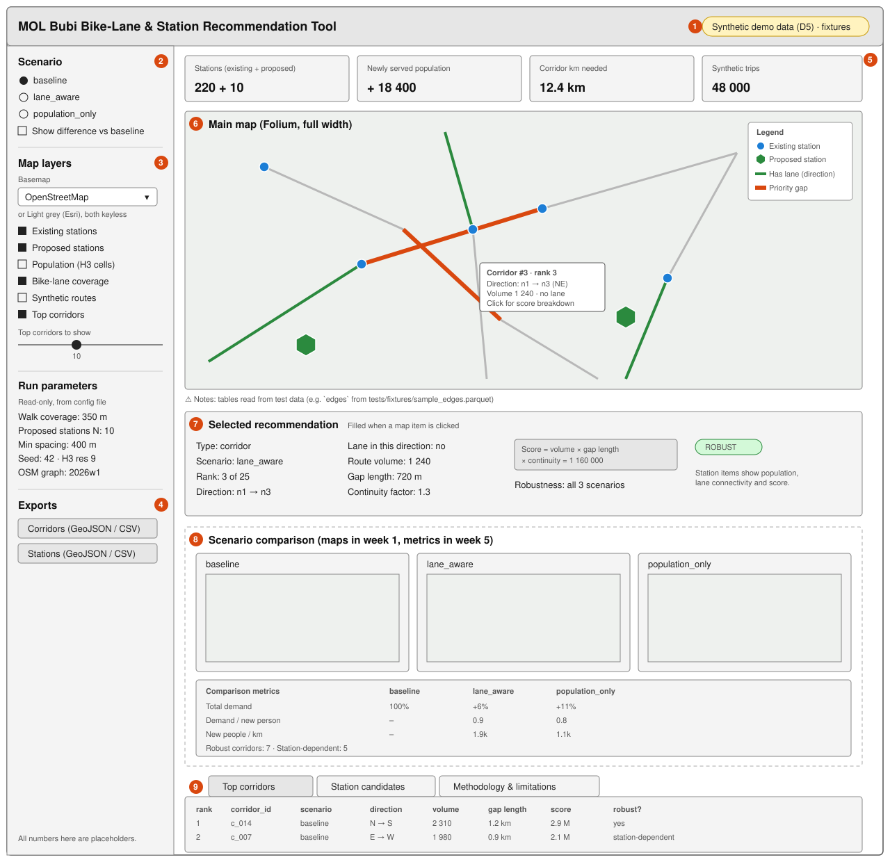

# Dashboard Wireframe (Week 1)

Issue: #8 · Module: `src/bubi/dashboard` · Owner: CS 4

The wireframe follows section 6.7 and the demo storyline in section 9 of the technical
design. All numbers on it are placeholders.

## Areas

| # | Area | What it shows | Data source | Week |
|---|------|---------------|-------------|------|
| 1 | Data-mode badge | Always visible label that results are synthetic (decision D5), and whether the app reads `data/processed/` or `tests/fixtures/` | app state | 1 |
| 2 | Scenario selector | `baseline`, `lane_aware`, `population_only`, plus a "difference vs baseline" toggle | config `scenarios.active` | 1 (selector), 5 (difference) |
| 3 | Map layers | Existing stations, proposed stations, population (H3), per-direction bike-lane coverage, synthetic routes, top corridors; slider for how many corridors to show | `stations`, `station_candidates`, `population`, `edges`, `routes`, `corridors` | 1 (stations, edges, population, corridors), 3 (routes) |
| 4 | Exports | Corridors and stations as GeoJSON and CSV | `corridors` + `edges`, `stations` + `station_candidates` | 1 (CSV), 5 (GeoJSON) |
| 5 | Key metrics | Station count, newly served population, km of new corridor needed, synthetic trip count | scenario outputs | 1 (counts), 5 (served population, km) |
| 6 | **Main map area** | Folium map. Lanes drawn per direction: green = lane in that direction, grey = none, orange = priority gap. Tooltip shows rank, direction, volume, lane status | `edges`, `edge_scores`, `corridors` | 1 |
| 7 | Selected recommendation | Score breakdown for the clicked corridor or station (traceability check in section 9): volume, gap length, continuity factor, rank, scenario, robustness label | `edge_scores`, `corridors`, `station_candidates` | 4 |
| 8 | **Scenario comparison space** | Small maps per scenario, demand in absolute terms and per newly served person, newly served people per km of new corridor, robust vs station-dependent corridors (section 7.3) | derived view over `edge_scores` | 5 |
| 9 | Tables | Tabs for top corridors, station candidates, methodology and limitations (section 13.2) | `corridors`, `station_candidates` | 1 (tables), 6 (methodology) |

## Interaction flow

1. Pick a scenario in the sidebar; map, metrics and tables update.
2. Turn layers on and off to compare bike-lane coverage with high-use corridors.
3. Click a corridor or station on the map to see its score breakdown in the right panel.
4. Scroll down to compare scenarios and see which corridors are robust.
5. Export the current scenario's recommendations.

## Open questions for review

- Should the third scenario map (`population_only`) always be visible, or only through the selector?
- Is the right-hand detail panel worth the map width it takes on a projector? Alternative: show the
  breakdown under the map.
- Which basemap reads best on the presentation projector? The default is OpenStreetMap, because
  CartoDB basemaps now require an API key. A lighter keyless basemap may make the lane colours clearer.

## Review feedback

| Date | Reviewer | Feedback | Decision |
|------|----------|----------|----------|
| | | | |
